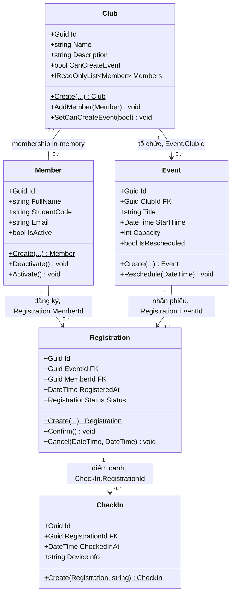

# Sơ đồ lớp Domain Model

`Id` là khóa chính của mỗi entity. Các khóa ngoại hiện diện trong source C# và Python là `Event.ClubId`, `Registration.EventId`, `Registration.MemberId` và `CheckIn.RegistrationId`. Quan hệ nhiều-nhiều Club-Member hiện được giữ trong danh sách nội bộ `Club.Members`; bảng nối chỉ là hướng triển khai khi có cơ sở dữ liệu ở chương sau.
