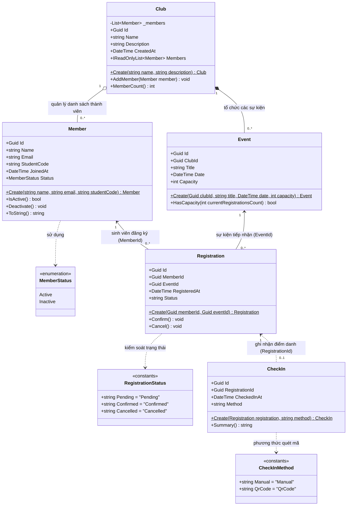

# Sơ đồ lớp miền — Hệ sinh thái EduHub (Ch01)

Sơ đồ lớp chi tiết của 5 thực thể Rich Domain Model trong hệ thống EduHub, thể hiện thuộc tính, kiểu dữ liệu, phương thức nghiệp vụ, khóa ngoại và các mối quan hệ (1:1, 1:N, M:N).

---

## 🔒 Quy tắc bất biến (Invariants) được mã hóa trong mô hình:
1. **Tính đóng gói (Encapsulation)**:
   - Các trường dữ liệu đều có `private set;`, không có setter công khai tùy tiện.
   - Hàm dựng `constructor` đều đặt ở phạm vi `private`, bắt buộc mọi luồng khởi tạo phải đi qua phương thức tĩnh `Create(...)`.
2. **Quy tắc thực thể CLB**:
   - `Club.AddMember()` kiểm tra không cho phép thêm cùng một sinh viên hai lần vào CLB (`InvalidOperationException`).
   - `Club.Members` trả về `IReadOnlyList<Member>` để ngăn chặn thao tác thêm/sửa/xóa trực tiếp từ bên ngoài.
3. **Quy tắc đăng ký & Điểm danh**:
   - `Registration.Status`: Chuyển từ `Pending` sang `Confirmed` hoặc `Cancelled`. Khi đã `Cancelled` thì không bao giờ được phép `Confirm()` lại.
   - `CheckIn.Create()`: Bắt buộc phiếu `Registration` phải có trạng thái `Confirmed` mới được phép điểm danh.
